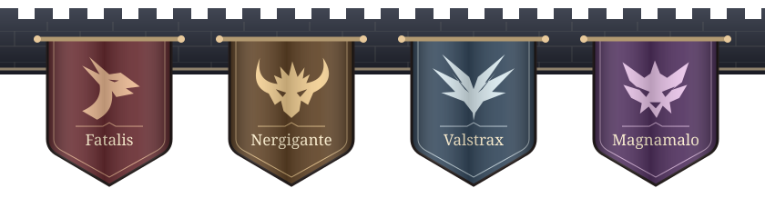

<h1 align="center"><a href="https://www.linkedin.com/in/andre-ancco-condori-811917394">Andre Favio Ancco Condori</a></h1>

Desarrollo web full stack · Tecsup Arequipa · <a href="https://www.linkedin.com/in/andre-ancco-condori-811917394">LinkedIn</a>

<h2 align="center">Tecnologías y herramientas</h2>

<table align="center">
<tr>
<td align="center" width="33%"><strong>Lenguajes</strong>      C# · Python · JavaScript · Dart</td>
<td align="center" width="33%"><strong>Web y móvil</strong>      HTML · CSS · React · Flutter</td>
<td align="center" width="33%"><strong>Backend</strong>    Node.js · ASP.NET Core Entity Framework Core · LINQ</td>
</tr>
<tr>
<td align="center" width="33%"><strong>Datos</strong>     PostgreSQL · MongoDB · scikit-learn Streamlit · Kaggle</td>
<td align="center" width="33%"><strong>Herramientas</strong>      Git · GitHub · Rider · VS Code DBeaver</td>
<td align="center" width="33%"><strong>Sistemas empresariales</strong>  SAP FI · ABAP</td>
</tr>
</table>

