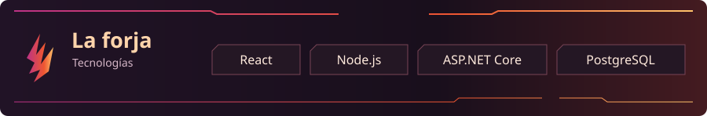

<h1 align="center">Andre Ancco</h1>

<i>La guarida del dragón negro</i>

Estudio en Tecsup Arequipa. Me gusta crear aplicaciones web y trabajar tanto en la interfaz como en la lógica que hay detrás.

## Tablón de misiones

| Proyecto | Qué encontrarás |
| --- | --- |
| [Auditel Web](https://github.com/andre-favio-dev-sys/auditel-web) | Sitio web desarrollado con Astro. |
| [Portafolio personal](https://github.com/andre-favio-dev-sys/portafolio_Andre) | Mi portafolio web en HTML. |
| [Hola mundo con Kafka](https://github.com/andre-favio-dev-sys/kafka-hola-mundo) | Una práctica de Apache Kafka con Python. |

